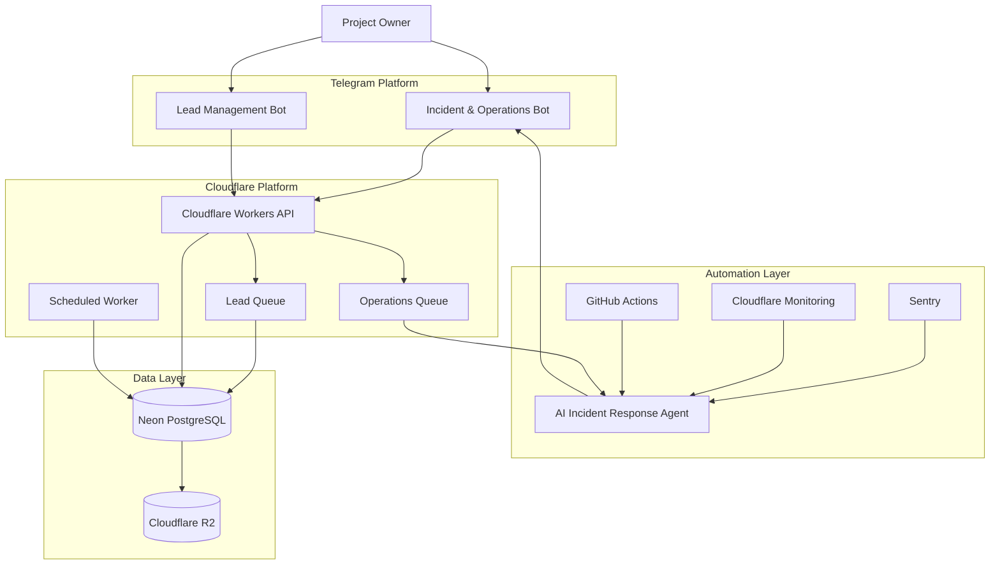

# TECH-001 — Telegram Bots & Automation Architecture

**Project:** «Братья» / եղբայրներ  
**Document ID:** TECH-001  
**Version:** 0.1  
**Status:** Draft  
**Document Type:** Technical Architecture Specification  
**Related Documents:** BRD-001, SRS-001, SAD-001, IA-001, API-001, DATA-001, ADR-001, TEST-001, DEPLOY-001, OPS-001

---

## 1. Purpose

TECH-001 определяет архитектуру Telegram-ботов и автоматизированных процессов для эксплуатации платформы строительной компании «Братья».

Документ описывает:

- архитектуру двух Telegram-ботов;
- взаимодействие с Cloudflare Workers;
- интеграцию с Neon PostgreSQL;
- обработку событий через Cloudflare Queues;
- взаимодействие с AI Incident Response Agent;
- управление заявками;
- автоматические напоминания;
- авторизацию и разграничение доступа;
- API-контракты;
- обработку ошибок;
- аудит действий;
- тестирование и deployment.

Основная задача — создать единую операционную систему, позволяющую владельцу проекта контролировать техническое состояние платформы и обрабатывать клиентские заявки непосредственно через Telegram.

## 2. Architecture Decisions

### 2.1. Two Independent Telegram Bots

Для MVP предусматриваются два логически и технически разделённых Telegram-бота.

**Bot A — Incident & Operations Bot**

Назначение:

- получение критических уведомлений;
- взаимодействие с AI Incident Response Agent;
- просмотр информации об инцидентах;
- получение диагностики;
- подтверждение разрешённых операционных действий;
- получение deployment и monitoring alerts.

**Bot B — Lead Management Bot**

Назначение:

- получение уведомлений о новых заявках;
- просмотр и поиск заявок;
- изменение статусов;
- добавление заметок;
- создание напоминаний;
- получение статистики;
- автоматическая подготовка ежедневной сводки.

Разделение необходимо для изоляции прав, credentials и бизнес-процессов.

### 2.2. Architecture Principles

1. PostgreSQL — единственный источник истины для заявок.
2. Telegram — пользовательский интерфейс, а не база данных.
3. AI Agent не имеет прямого доступа к PostgreSQL.
4. Боты работают через защищённые API.
5. Каждый бот использует отдельный Telegram Bot Token.
6. Каждое действие пользователя проверяется сервером.
7. Все изменения заявок сохраняются в audit trail.
8. Асинхронные процессы используют Cloudflare Queues.
9. Критические production operations требуют подтверждения владельца.
10. Отказ одного бота не должен блокировать работу другого.

## 3. High-Level Architecture

### 3.1. System Overview



### 3.2. Logical Components

| Component | Responsibility |
| --- | --- |
| Incident Bot | Технические уведомления и команды |
| Lead Bot | Управление заявками |
| AI Incident Agent | Диагностика и анализ инцидентов |
| Operations API | Обработка операционных запросов |
| Lead Management API | Управление заявками |
| Operations Queue | Асинхронная обработка операционных событий |
| Lead Queue | Асинхронная обработка команд и уведомлений |
| Scheduled Worker | Напоминания и периодические задачи |
| Neon PostgreSQL | Хранение бизнес- и операционных данных |
| Sentry | Application error monitoring |

Схема показывает логические компоненты. Их физическое размещение и границы Worker Services уточняются при реализации.

## 4. Technology Stack

| Layer | Technology |
| --- | --- |
| Telegram Interface | Telegram Bot API |
| Backend Runtime | Cloudflare Workers |
| API | TypeScript |
| Database | Neon PostgreSQL |
| ORM | Drizzle ORM |
| Queue | Cloudflare Queues |
| Scheduled Jobs | Cloudflare Cron Triggers |
| Validation | Zod |
| Incident Monitoring | Sentry |
| Infrastructure Monitoring | Cloudflare Observability |
| CI/CD | GitHub Actions |
| AI Incident Agent | Cursor Automations или совместимый аналог |
| Secrets | Cloudflare Worker Secrets |
| Testing | Vitest, Playwright |
| Formatting/Linting | Oxlint, oxfmt, TypeScript |

Дополнительные зависимости вводятся только при наличии конкретной технической необходимости.

## 5. Bot A — Incident & Operations Bot

### 5.1. Purpose

Incident Bot предназначен для автоматизированного мониторинга и управления техническими инцидентами.

Основной получатель критических уведомлений — владелец проекта.

### 5.2. Event Sources

Бот получает события через AI Incident Response Agent и интеграционные обработчики.

Источники:

- Sentry;
- Cloudflare Workers;
- Cloudflare Queues;
- Neon monitoring;
- GitHub Actions;
- deployment events;
- security alerts.

### 5.3. AI Agent Responsibilities

AI Agent выполняет:

1. Получение события.
2. Проверку его достоверности и источника.
3. Классификацию severity.
4. Группировку повторяющихся ошибок.
5. Анализ stack traces.
6. Сопоставление с deployment metadata.
7. Формирование технического резюме.
8. Подготовку рекомендуемого решения.
9. Отправку уведомления в Incident Bot.
10. Подготовку post-incident summary.

AI Agent не должен самостоятельно принимать необратимые решения в production.

### 5.4. Incident Severity

- `SEV-1` — Critical.
- `SEV-2` — High.
- `SEV-3` — Medium.
- `SEV-4` — Low.

Правила классификации определяются OPS-001.

### 5.5. Telegram Commands

Предлагаемые команды:

- `/start` — регистрация и главное меню.
- `/status` — краткий статус системы.
- `/incidents` — активные инциденты.
- `/incident ID` — подробности инцидента.
- `/alerts` — последние критические уведомления.
- `/deployments` — последние deployments.
- `/help` — справка.

### 5.6. Incident Message

Пример сообщения:

```text
🚨 PRODUCTION INCIDENT

Incident: INC-2026-001
Severity: SEV-1
Component: Lead API
Environment: Production

Problem:
API returns HTTP 500 errors.

Business impact:
New customer requests may not be accepted.

AI Analysis:
Possible database connection failure.

Recommended action:
Check Neon connectivity and recent Worker deployment.

Status: INVESTIGATING
```

### 5.7. Inline Actions

Для инцидента могут быть доступны:

- `View Details`
- `Refresh Status`
- `Show Logs`
- `AI Analysis`
- `Acknowledge`
- `Resolve`

Кнопки не должны выполнять критические операции без дополнительной серверной проверки.

### 5.8. Acknowledge and Resolve

`Acknowledge` означает, что владелец увидел инцидент и принял его в работу.

`Resolve` означает подтверждение восстановления после проверки.

Получение уведомления не должно автоматически закрывать инцидент.

## 6. Bot B — Lead Management Bot

### 6.1. Purpose

Lead Management Bot обеспечивает автоматизированную обработку входящих заявок.

Он заменяет необходимость создания отдельной CRM или Admin Panel на первом этапе.

### 6.2. Main Features

- уведомление о новой заявке;
- просмотр новых заявок;
- просмотр карточки клиента;
- поиск;
- изменение статуса;
- добавление заметок;
- создание напоминаний;
- автоматические follow-ups;
- ежедневная статистика;
- история обработки.

### 6.3. Main Menu

Предлагаемая структура:

```text
🏗 Братья — Lead Management

[ Новые заявки ]
[ Все заявки ]
[ Поиск ]
[ Напоминания ]

[ Статистика ]
[ Ежедневная сводка ]

[ Настройки ]
[ Помощь ]
```

### 6.4. Telegram Commands

- `/start` — главное меню.
- `/new` — новые заявки.
- `/leads` — список заявок.
- `/lead ID` — карточка заявки.
- `/search` — поиск.
- `/stats` — статистика.
- `/reminders` — напоминания.
- `/help` — справка.

Inline keyboard является основным интерфейсом. Команды нужны для быстрого доступа и диагностики.

### 6.5. New Lead Notification

При сохранении новой заявки:

1. API создаёт запись в PostgreSQL.
2. Создаёт запись в `notification_outbox`.
3. Асинхронно публикует событие в Lead Queue.
4. Consumer получает событие.
5. Consumer отправляет сообщение через Telegram Bot API.
6. Результат доставки фиксируется.

Пример:

```text
🔔 НОВАЯ ЗАЯВКА

Lead ID: #1042
Имя: Арман
Услуга: Ремонт квартиры
Телефон: +374 XX XXX XXX
Контакт: WhatsApp
Язык: HY

Сообщение:
Интересует капитальный ремонт квартиры.

Источник:
Google / Organic

Статус: NEW

[Открыть заявку]
[Позвонить]
[WhatsApp]
```

Кнопки связи используют только предоставленные клиентом контактные данные. Перед открытием внешнего URL необходимо безопасно сформировать ссылку и проверить её формат.

### 6.6. Lead Card

Полная карточка:

```text
LEAD #1042

Клиент: Арман
Телефон: +374 XX XXX XXX
Email: client@example.com

Услуга: Ремонт квартиры
Контакт: WhatsApp
Язык: HY

Создано: 19.11.2026
Источник: Google Organic

Статус: NEW

История:
19.11.2026 — Заявка создана.

[Связаться]
[Изменить статус]
[Добавить заметку]
[Создать напоминание]
[История]
```

Реальные персональные данные не должны присутствовать в тестовых примерах и технических логах.

### 6.7. Lead Status Lifecycle

Начальные статусы:

- `NEW`
- `CONTACTED`
- `QUALIFIED`
- `ESTIMATE_SENT`
- `WON`
- `LOST`
- `SPAM`

Все изменения статуса должны выполняться через API и сохраняться в `lead_events`.

### 6.8. Status Transition Rules

Рекомендуемые переходы:

```text
NEW
 ├── CONTACTED
 └── SPAM

CONTACTED
 ├── QUALIFIED
 ├── LOST
 └── SPAM

QUALIFIED
 ├── ESTIMATE_SENT
 └── LOST

ESTIMATE_SENT
 ├── WON
 └── LOST
```

Переход из `LOST` или `SPAM` обратно в активный статус требует отдельного действия с указанием причины.

`WON` и `LOST` считаются завершёнными бизнес-состояниями на уровне MVP.

### 6.9. Lead Notes

Заметки предназначены для внутренней работы.

Примеры:

- Клиент хочет начать ремонт в январе.
- Нужен выезд на объект.
- Ожидается план квартиры.
- Требуется предварительная оценка бюджета.

Заметки не отправляются клиенту автоматически.

### 6.10. Reminders

Бот поддерживает:

- напоминание связаться с клиентом;
- напоминание подготовить смету;
- напоминание отправить предложение;
- напоминание повторно связаться;
- произвольное следующее действие.

Каждое напоминание содержит:

- `reminderId`;
- `leadId`;
- `dueAt`;
- `message`;
- `status`;
- `createdBy`;
- `createdAt`.

Статусы напоминания:

- `PENDING`;
- `SENT`;
- `COMPLETED`;
- `CANCELLED`.

### 6.11. Automated Follow-up Rules

Начальные правила:

| Condition | Action |
| --- | --- |
| New lead created | Immediate Telegram notification |
| NEW for 2 hours | Reminder |
| NEW for 24 hours | Escalated reminder |
| Reminder due | Telegram notification |
| Daily schedule | Daily summary |

Напоминания не должны отправляться для `SPAM`, `LOST` и `WON`, если нет специально созданной задачи.

Повторные уведомления должны учитывать timezone и текущий статус заявки.

## 7. Telegram Authentication and Authorization

### 7.1. User Authentication

В MVP используется allowlist Telegram user IDs.

Только заранее разрешённые Telegram accounts могут использовать ботов.

### 7.2. Authorization Rules

Каждый запрос проверяется на сервере.

Проверяются:

- Telegram user ID;
- bot identity;
- доступная операция;
- environment;
- callback payload;
- message/update identity;
- request authorization.

Нельзя доверять `userId`, `role` или `leadId`, полученным только из пользовательского текста или callback data без проверки.

### 7.3. Roles

Предусмотреть расширяемую модель:

- `OWNER` — полный разрешённый операционный доступ;
- `OPERATOR` — работа с заявками;
- `VIEWER` — просмотр разрешённых данных.

В MVP активируется только `OWNER`, если нет необходимости подключать других сотрудников.

### 7.4. Webhook Security

Для каждого бота используется отдельный webhook endpoint.

Рекомендуемая структура:

- `/api/v1/webhooks/telegram/incident`
- `/api/v1/webhooks/telegram/leads`

Telegram webhook должен проверять заголовок `X-Telegram-Bot-Api-Secret-Token`.

Также необходимо:

- использовать HTTPS;
- хранить Bot Tokens в Cloudflare Worker Secrets;
- ограничивать доступ к внутренним endpoints;
- проверять корректность Telegram Update;
- защищаться от повторной обработки update;
- не записывать Bot Tokens в логи.

### 7.5. Idempotency

Telegram Updates содержат `update_id`.

Он используется для защиты от повторной обработки одного события.

Обработанные update IDs должны иметь уникальное ограничение в хранилище или эквивалентный механизм дедупликации.

## 8. API Architecture

### 8.1. API Structure

Публичный API остаётся отдельным от внутренних API ботов.

**Public API**

- `POST /api/v1/leads`
- `GET /api/v1/health`

**Telegram Webhooks**

- `POST /api/v1/webhooks/telegram/incident`
- `POST /api/v1/webhooks/telegram/leads`

**Lead Internal API**

- `GET /api/v1/internal/leads`
- `GET /api/v1/internal/leads/{id}`
- `PATCH /api/v1/internal/leads/{id}/status`
- `POST /api/v1/internal/leads/{id}/notes`
- `POST /api/v1/internal/leads/{id}/reminders`
- `GET /api/v1/internal/reminders`
- `GET /api/v1/internal/stats`

**Operations Internal API**

- `GET /api/v1/internal/operations/status`
- `GET /api/v1/internal/operations/incidents`
- `GET /api/v1/internal/operations/incidents/{id}`
- `POST /api/v1/internal/operations/incidents/{id}/acknowledge`
- `POST /api/v1/internal/operations/incidents/{id}/resolve`

Внутренние endpoints не являются публичными интерфейсами и не должны быть доступны анонимным пользователям.

### 8.2. API Validation

Использовать Zod для проверки:

- path parameters;
- query parameters;
- request body;
- Telegram updates;
- callback payloads;
- status transitions;
- reminder data.

### 8.3. Error Response

Стандартизированный формат:

```json
{
  "success": false,
  "error": {
    "code": "LEAD_NOT_FOUND",
    "message": "Lead not found",
    "requestId": "req_123"
  }
}
```

В production response не включаются stack traces и внутренние технические сведения.

### 8.4. Pagination

Для списков заявок и инцидентов использовать cursor-based pagination.

Не загружать весь список заявок при каждом запросе.

Рекомендуемый начальный размер страницы — 10 записей.

## 9. Database Architecture

### 9.1. Existing Entities

Используются существующие сущности:

- `leads`;
- `lead_attribution`;
- `lead_events`;
- `notification_outbox`;
- `idempotency_keys`.

### 9.2. Additional Entities

Для реализации Telegram automation предлагаются следующие расширения.

**bot_users**

Хранит разрешённых Telegram пользователей:

- `id`;
- `telegram_user_id`;
- `role`;
- `is_active`;
- `created_at`;
- `updated_at`.

Telegram user ID должен иметь уникальное ограничение.

**telegram_updates**

Защищает от повторной обработки:

- `id`;
- `bot_type`;
- `telegram_update_id`;
- `processed_at`;
- `status`.

Уникальность определяется сочетанием `bot_type` и `telegram_update_id`.

**lead_notes**

Хранит внутренние заметки:

- `id`;
- `lead_id`;
- `author_id`;
- `content`;
- `created_at`.

**lead_reminders**

Хранит задачи и напоминания:

- `id`;
- `lead_id`;
- `created_by`;
- `message`;
- `due_at`;
- `status`;
- `sent_at`;
- `completed_at`;
- `created_at`;
- `updated_at`.

**bot_notification_deliveries**

Хранит состояние доставки уведомлений:

- `id`;
- `notification_id`;
- `bot_type`;
- `recipient_id`;
- `status`;
- `attempt_count`;
- `last_error_code`;
- `sent_at`;
- `created_at`.

### 9.3. Existing Audit Trail

`lead_events` расширяется для регистрации:

- статуса до изменения;
- нового статуса;
- actor ID;
- action type;
- timestamp;
- correlation ID.

Для внутренних заметок и напоминаний также сохраняются audit events.

### 9.4. Data Retention

Retention policy для Telegram updates, notification delivery records, заметок и технических событий должна быть определена отдельно с учётом GDPR и операционных требований.

Не хранить Telegram message history целиком без необходимости.

## 10. Queue Architecture

### 10.1. Separate Queues

Рекомендуется разделить очереди по назначению:

- `operations-events`;
- `lead-commands`;
- `lead-notifications`.

`operations-events` используется для технических событий.

`lead-commands` — для асинхронной обработки пользовательских команд, когда это необходимо.

`lead-notifications` — для доставки уведомлений о заявках и напоминаний.

### 10.2. Processing Flow

**Lead Submission**

1. Клиент отправляет форму.
2. API валидирует запрос.
3. PostgreSQL сохраняет заявку и Outbox event.
4. Outbox publisher публикует событие.
5. Queue Consumer отправляет Telegram notification.
6. Delivery status сохраняется.

**Lead Status Update**

1. Telegram Bot получает callback.
2. API проверяет Telegram user ID и права.
3. API валидирует переход статуса.
4. PostgreSQL обновляет заявку и создаёт `lead_events`.
5. Бот подтверждает операцию.
6. Пользователь получает обновлённую карточку.

Изменение статуса и запись audit event должны выполняться в одной PostgreSQL transaction.

### 10.3. Retry Policy

Использовать политику OPS-001:

- 1 минута;
- 5 минут;
- 15 минут;
- 60 минут;
- после пятой неудачной попытки — DLQ.

Consumer должен поддерживать idempotency.

### 10.4. Queue Failure

Если Queue Consumer недоступен:

- заявки остаются в PostgreSQL;
- Outbox events сохраняются;
- отправка уведомлений откладывается;
- после восстановления выполняется повторная обработка;
- дубликаты предотвращаются idempotency mechanism.

## 11. Scheduled Automation

### 11.1. Scheduled Worker

Cloudflare Cron Triggers используются для периодических задач.

Предусматриваются следующие задачи:

**Reminder Processor**

- проверяет наступившие напоминания;
- отправляет Telegram notification;
- обновляет состояние доставки;
- предотвращает повторную отправку.

**New Lead Follow-up**

- проверяет необработанные заявки;
- создаёт напоминания через 2 и 24 часа;
- учитывает актуальный статус;
- не отправляет напоминания для закрытых заявок.

**Daily Summary**

- агрегирует статистику;
- формирует сводку;
- отправляет её через Lead Management Bot.

**Outbox Reconciliation**

- проверяет несогласованные Outbox events;
- повторно публикует недоставленные события;
- выявляет застрявшие записи.

### 11.2. Execution Frequency

Начальная конфигурация:

- reminder processing — каждую минуту;
- outbox reconciliation — каждые 5 минут;
- new lead follow-up — каждые 5 минут;
- daily summary — один раз в день.

Планировщик должен использовать идемпотентные операции.

Повторный запуск одного Cron job не должен приводить к повторной отправке одного и того же уведомления.

### 11.3. Timezone

Для ежедневной сводки и напоминаний используется явная настройка timezone.

Timezone не должна определяться по локальному времени сервера.

Рекомендуется хранить timestamps в UTC и выполнять отображение в настроенной timezone компании.

## 12. AI Automation Architecture

### 12.1. AI Incident Agent

AI Agent является отдельным компонентом и не является частью Lead Management Bot.

Его назначение:

- анализ ошибок;
- анализ deployment events;
- корреляция инцидентов;
- техническое резюме;
- рекомендации;
- уведомления.

### 12.2. Integration

Предлагаемый поток:

```text
Sentry / Cloudflare / GitHub
          |
          v
   Event Webhook
          |
          v
  AI Incident Agent
          |
          v
 Incident Summary
          |
          v
 Incident Bot
          |
          v
     Project Owner
```

Конкретный инструмент выбирается после проверки его webhook, MCP и permission capabilities.

### 12.3. AI Agent Data Access

Разрешено передавать:

- error messages;
- stack traces после sanitization;
- release metadata;
- environment;
- request IDs;
- технические метрики;
- разрешённые диагностические логи.

Запрещено передавать без специального разрешения:

- клиентские телефоны;
- Email;
- полные сообщения клиентов;
- database credentials;
- API tokens;
- secrets;
- необработанные production database records.

### 12.4. AI Reliability

AI Agent не является единственным источником мониторинга.

При недоступности AI Agent прямые Sentry/Cloudflare alerts должны продолжать работать.

AI-диагностика считается рекомендацией, а не подтверждённой первопричиной, пока она не проверена.

### 12.5. AI Cost Control

- группировать повторяющиеся события;
- не запускать анализ для каждого одинакового error event;
- ограничить объём передаваемых логов;
- использовать event deduplication;
- задавать максимальный размер контекста;
- не запускать бесконечные циклы повторной диагностики.

## 13. Security Architecture

### 13.1. Token Isolation

Для каждого бота отдельный token:

- `TELEGRAM_INCIDENT_BOT_TOKEN`;
- `TELEGRAM_LEADS_BOT_TOKEN`.

Webhook secrets:

- `TELEGRAM_INCIDENT_WEBHOOK_SECRET`;
- `TELEGRAM_LEADS_WEBHOOK_SECRET`.

Production и staging используют отдельные credentials.

### 13.2. Authorization

- Telegram user ID allowlist;
- server-side authorization;
- role-based access;
- request validation;
- audit logging;
- rate limiting;
- callback validation.

### 13.3. Internal API Protection

Внутренние endpoints должны быть защищены и не должны полагаться только на секретность URL.

Проверка доступа выполняется на каждом запросе.

Рекомендуется отдельная service identity для каждого бота.

### 13.4. Callback Security

Callback data не должна содержать персональные данные или доверенные значения прав доступа.

Использовать короткие идентификаторы действий, которые сервер сопоставляет с разрешённой операцией.

Для критических операций callback должен иметь ограниченный срок действия и проверяться на соответствие исходному пользователю и сообщению.

### 13.5. Audit Logging

Записывать:

- actor;
- action;
- target entity;
- previous state;
- new state;
- timestamp;
- correlation ID.

Не записывать secrets и необработанные клиентские сообщения в технические логи.

## 14. Error Handling

### 14.1. Telegram API Errors

Обрабатывать:

- rate limiting;
- HTTP 429;
- HTTP 5xx;
- invalid token;
- blocked bot;
- chat not found;
- invalid callback;
- network timeout.

При HTTP 429 учитывать `retry_after`, если он предоставлен Telegram.

### 14.2. API Errors

Стандартные категории:

- `UNAUTHORIZED`;
- `FORBIDDEN`;
- `VALIDATION_ERROR`;
- `LEAD_NOT_FOUND`;
- `INVALID_STATUS_TRANSITION`;
- `DUPLICATE_UPDATE`;
- `RATE_LIMITED`;
- `INTERNAL_ERROR`.

### 14.3. User Feedback

Пользователь должен получать понятный ответ:

- действие успешно выполнено;
- заявка не найдена;
- недостаточно прав;
- действие невозможно для текущего статуса;
- временная техническая ошибка;
- операция будет повторена автоматически.

Не показывать пользователю stack traces и внутренние credentials.

## 15. Testing Strategy

### 15.1. Unit Tests

- Zod validation;
- authorization;
- status transition rules;
- idempotency;
- reminder scheduling;
- notification formatting;
- callback parsing.

### 15.2. Integration Tests

- Telegram webhook;
- Worker API;
- PostgreSQL;
- Drizzle transactions;
- Cloudflare Queues;
- Outbox publisher;
- Queue Consumer;
- Cron jobs;
- Telegram API mock.

### 15.3. Security Tests

- unauthorized Telegram user;
- forged callback;
- duplicate update;
- replayed webhook;
- invalid webhook secret;
- expired action;
- cross-bot token misuse;
- access to another user's data;
- rate limiting;
- secrets leakage in logs.

### 15.4. End-to-End Tests

**Lead Flow**

1. Отправка тестовой формы.
2. Сохранение заявки.
3. Telegram notification.
4. Открытие карточки.
5. Изменение статуса.
6. Добавление заметки.
7. Создание напоминания.
8. Получение напоминания.
9. Проверка audit trail.

**Incident Flow**

1. Генерация тестового Sentry event.
2. Получение события AI Agent.
3. Формирование incident summary.
4. Отправка Telegram alert.
5. Acknowledge.
6. Проверка восстановления.
7. Resolve.

### 15.5. Acceptance Criteria

- Оба бота работают независимо.
- Неавторизованный пользователь не получает доступ к данным.
- Повторный Telegram update не создаёт повторных действий.
- Новая заявка сохраняется до отправки уведомления.
- Изменение статуса сохраняется вместе с audit event.
- Напоминания не отправляются повторно.
- Queue failures не приводят к потере заявок.
- AI Agent не получает доступ к клиентским данным без необходимости.
- Критические уведомления доставляются владельцу.
- Recovery и retry procedures протестированы.

## 16. Deployment and Configuration

### 16.1. Bot Environments

Staging и production используют разные Telegram bots.

Это предотвращает случайную отправку тестовых сообщений владельцу или клиентам в production.

### 16.2. Secrets

Все secrets хранятся в Cloudflare Worker Secrets или соответствующем защищённом secret store.

Не хранить:

- Bot Tokens;
- webhook secrets;
- AI provider credentials;
- API credentials;
- database URLs

в Git или публичной конфигурации.

### 16.3. Deployment

- конфигурация хранится в Git;
- изменения проходят Pull Request;
- CI проверяет типы, тесты и безопасность;
- staging deployment автоматизирован;
- production deployment требует ручного approval;
- Bot webhook configuration проверяется после deployment.

### 16.4. Rollback

При проблеме:

1. остановить проблемный release;
2. вернуть предыдущую версию Worker;
3. проверить webhook endpoints;
4. проверить Queue processing;
5. проверить сохранность заявок;
6. проверить доступность обоих ботов.

Изменения schema требуют отдельной совместимой recovery strategy.

## 17. Proposed Repository Structure

```text
apps/
  web/
    src/
      pages/
      components/
      content/

  worker/
    src/
      api/
        public/
        internal/
      webhooks/
        telegram/
          incident/
          leads/
      services/
        leads/
        incidents/
        notifications/
        reminders/
      queues/
        operations-events/
        lead-commands/
        lead-notifications/
      scheduled/
      security/
      validation/

packages/
  database/
    src/
      schema/
      migrations/
      repositories/

  contracts/
    src/
      api/
      telegram/
      events/

  shared/
    src/
      types/
      constants/
      utils/

tests/
  unit/
  integration/
  e2e/
```

Это предлагаемая логическая структура. Финальная структура должна быть согласована с существующим repository layout и DEPLOY-001.

## 18. Implementation Roadmap

### Phase 1 — Infrastructure and Security

- создание двух Telegram bots;
- создание отдельных credentials;
- настройка webhooks;
- авторизация владельца;
- защищённые internal API;
- базовый logging.

### Phase 2 — Lead Management Bot

- уведомление о новой заявке;
- просмотр заявок;
- карточка заявки;
- изменение статусов;
- заметки;
- audit trail.

### Phase 3 — Automation

- reminders;
- 2-hour и 24-hour follow-ups;
- daily summary;
- Queue retry и DLQ;
- Outbox reconciliation.

### Phase 4 — Incident Bot

- Sentry integration;
- Cloudflare monitoring events;
- GitHub deployment events;
- AI Agent integration;
- Telegram alerts;
- incident lifecycle.

### Phase 5 — Validation and Production

- security testing;
- E2E testing;
- load testing;
- failure simulation;
- staging validation;
- production rollout.

## 19. Open Technical Decisions

Следующие решения требуют проверки или отдельного утверждения.

**OD-TECH-001-01 — AI Incident Agent**

Выбрать Cursor Automations или альтернативный инструмент после проверки webhook/MCP, background execution, доступных permissions и стоимости.

**OD-TECH-001-02 — Bot Deployment Model**

Подтвердить, будут ли оба Telegram webhook handlers размещены в одном Cloudflare Worker deployment или в отдельных Workers. Логическое разделение credentials и прав обязательно в обоих случаях.

**OD-TECH-001-03 — Bot User Management**

Утвердить первоначальный состав пользователей и правила добавления дополнительных операторов.

**OD-TECH-001-04 — Internal API Authentication**

Утвердить service-to-service authentication между Telegram webhook handlers и внутренними сервисами.

**OD-TECH-001-05 — Reminder Scheduling**

Подтвердить Cron Triggers как механизм периодического выполнения и окончательную модель блокировки конкурентной обработки.

**OD-TECH-001-06 — Lead Data Retention**

Определить сроки хранения заявок, заметок, Telegram updates и delivery records.

**OD-TECH-001-07 — Daily Summary Schedule**

Утвердить время ежедневной сводки и timezone компании.

**OD-TECH-001-08 — Incident Actions**

Определить список действий, которые AI Agent может выполнять автоматически, и перечень операций, требующих подтверждения владельца.

## 20. Document Status

**Version:** 0.1  
**Status:** Draft  
**Owner:** Project Owner  
**Approval:** Pending technical validation

TECH-001 является техническим продолжением OPS-001 и определяет архитектуру Telegram automation.

Изменения API, базы данных, очередей, security model или AI Agent integration должны отражаться в связанных документах.

---

**End of Document — TECH-001 v0.1**
