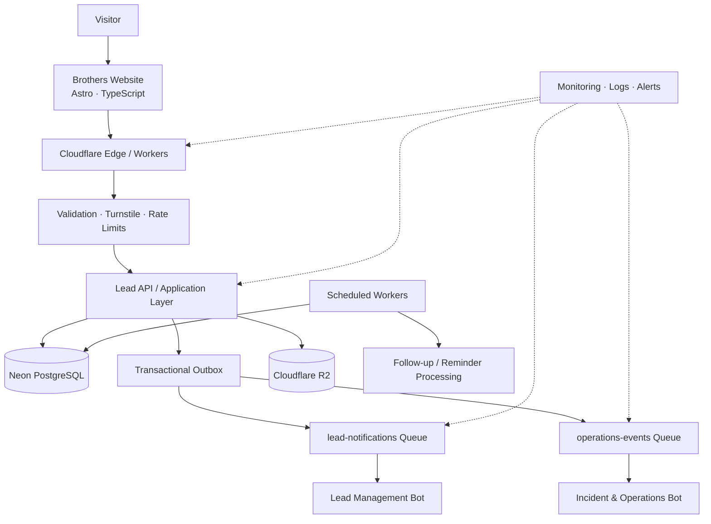
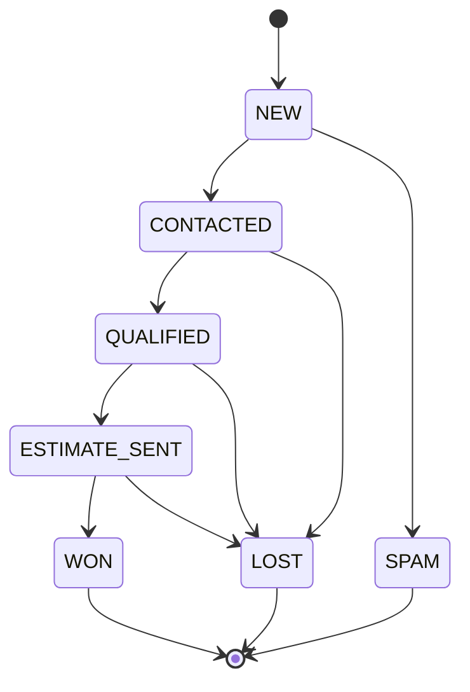
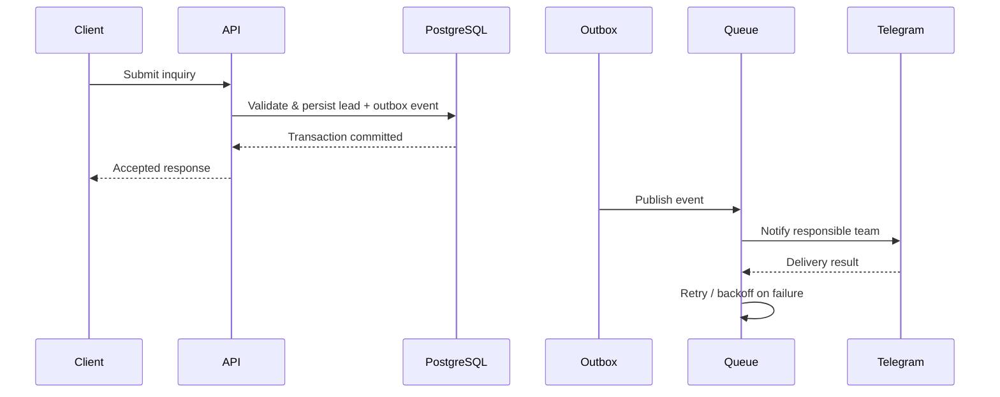

<div align="center">

# BROTHERS

## CONSTRUCTION · ARCHITECTURE · RENOVATION

**A premium digital platform for a modern construction business.**
Architecture-led presentation. Thoughtful client experience. Connected operations.

<br />

[Overview](#-overview) · [Services](#-business-focus) · [Platform](#-digital-platform) · [Architecture](#-system-architecture) · [Technology](#-technology-stack) · [Documentation](#-documentation) · [Roadmap](#-roadmap)

</div>

<p align="center">
  
</p>

<div align="center">

> **Building spaces. Creating value. Connecting every process.**

</div>

---

## ◈ Overview

**Brothers** is a construction and renovation business with a digital-first approach to presenting projects, acquiring clients, and coordinating business operations.

The platform is conceived as more than a company website. It connects a premium architectural portfolio and service presentation with a structured lead workflow, notification automation, and operational visibility.

> This repository contains the platform's product direction, technical architecture, specifications, and implementation workspace. Documentation describes the target system; individual features should not be considered production-ready until implemented and verified.

---

## ⌂ Business Focus

<table>
<tr>
<td width="50%">
<h3>🏗️ Construction</h3>
<p>Private houses, residential construction, structural work, and commercial projects.</p>
</td>
<td width="50%">
<h3>🛠️ Renovation</h3>
<p>Full renovations, interior finishing, modernization, and complex renovation work.</p>
</td>
</tr>
<tr>
<td width="50%">
<h3>◫ Architecture & Interiors</h3>
<p>Interior design, planning, spatial concepts, and architectural visualization.</p>
</td>
<td width="50%">
<h3>▧ Exterior & Envelope</h3>
<p>Facades, roofing, exterior finishing, and architectural details.</p>
</td>
</tr>
</table>

**Service geography:** Yerevan · Armenia · Regional projects · Armenian diaspora
**Positioning:** Medium+ / Premium

---

## ◈ Design Direction

The digital experience follows a premium architecture editorial direction:

- **Minimalism** — intentional layouts and restrained UI
- **Architectural imagery** — large-scale project photography and visual storytelling
- **Typography-led composition** — confident headlines and clear hierarchy
- **Material palette** — graphite, warm white, concrete, stone, and natural tones
- **Motion with purpose** — subtle transitions, progressive reveals, and no animation overload
- **Responsive by design** — considered experience across desktop, tablet, and mobile

<p align="center">
  
  
</p>

---

## ◈ Digital Platform

### Experience Layer

- Architecture-focused company website
- Project portfolio and case studies
- Before / after storytelling
- Video and rich media presentation
- Service pages and project inquiry flows
- Search-engine and AI-search discoverability foundations (SEO / GEO)

### Client Acquisition

- Structured inquiry form
- Server-side validation
- Bot and abuse protection
- Lead persistence
- Notification delivery
- Lead status and follow-up workflow

### Business Operations

- Telegram-based lead notifications
- Dedicated operational and incident notifications
- Retryable asynchronous processing
- Scheduled follow-up reminders
- Daily operational summaries (schedule to be finalized)
- Incident logging, monitoring, and recovery procedures

---

## ◈ System Architecture



<details>
<summary><strong>Architecture principles</strong></summary>

- Keep the public website fast and largely static where possible.
- Validate and protect incoming requests at the edge and application boundaries.
- Treat PostgreSQL as the durable source of truth for business records.
- Use queues for asynchronous work instead of coupling client requests to notification delivery.
- Use idempotent consumers and an Outbox pattern to reduce duplicate or lost processing.
- Keep critical operational alerting independent from AI-based analysis.
- Separate staging and production resources, credentials, and deployment workflows.
- AI incident analysis is read-only by default and must not be a dependency for critical alerts.

</details>

---

## ◈ Lead Lifecycle



| Status | Meaning |
|---|---|
| `NEW` | Inquiry received and awaiting review |
| `CONTACTED` | Initial contact made |
| `QUALIFIED` | Request confirmed as a relevant opportunity |
| `ESTIMATE_SENT` | Proposal or estimate sent to the client |
| `WON` | Project accepted |
| `LOST` | Opportunity closed without conversion |
| `SPAM` | Irrelevant or abusive inquiry |

Follow-up reminders are planned around configurable intervals. The current operational specification uses **2-hour and 24-hour** follow-up checkpoints, with reminder cancellation for terminal lead states.

---

## ◈ Async Processing & Reliability



### Reliability patterns

- Transactional Outbox
- Queue-based delivery
- Idempotency keys and duplicate-safe consumers
- Schema validation for event payloads
- Correlation IDs for tracing
- Retry and backoff policy
- Reconciliation process for stuck or missed events
- Dead-letter / failure handling
- Atomic reminder claiming and lease-based processing

---

## ◈ Technology Stack

<div align="center">

| Layer | Technologies |
|---|---|
| **Frontend** | Astro · TypeScript · React Islands · SCSS |
| **Motion** | GSAP — selective, performance-conscious use |
| **Edge & Runtime** | Cloudflare Pages · Workers |
| **Media Storage** | Cloudflare R2 |
| **Database** | Neon PostgreSQL · Drizzle ORM |
| **Async** | Cloudflare Queues · Scheduled Workers |
| **Messaging** | Telegram Bot API |
| **Email** | Resend |
| **Security** | Turnstile · server-side validation · scoped secrets |
| **CI/CD** | GitHub Actions |
| **Observability** | Sentry · structured logs · operational alerts |

</div>

---

## ◈ Infrastructure Map

| Component | Responsibility |
|---|---|
| **Cloudflare Pages** | Website delivery and deployment |
| **Cloudflare Workers** | API endpoints and server-side workflows |
| **Cloudflare R2** | Project media and object storage |
| **Neon PostgreSQL** | Leads, operational records, reminders, and durable state |
| **Cloudflare Queues** | Asynchronous notification and operations events |
| **Telegram — Leads** | Lead notifications and workflow communication |
| **Telegram — Operations** | Incidents, health events, and operational alerts |
| **Resend** | Transactional email delivery |
| **GitHub Actions** | Automated checks and deployment workflows |
| **Sentry** | Error and performance visibility |

---

## ◈ Security & Operations

Security and operational requirements are treated as part of the platform design—not as a final checklist.

- Environment separation: **staging / production**
- Separate bot identities, tokens, and webhook secrets
- Least-privilege credentials and scoped access
- Secret management through deployment environments
- Server-side validation and anti-abuse controls
- Sanitized event payloads and logs
- AI analysis separated from critical alert delivery
- Incident lifecycle and audit trail
- Backup and restore procedures
- Retry, reconciliation, and recovery playbooks

### Operational targets

| Objective | Target |
|---|---|
| **RPO** | 1 hour |
| **RTO** | 4 hours |
| **Queue reconciliation** | Every 5 minutes (planned) |
| **Reminder processing** | Every minute (planned) |
| **Follow-up checkpoints** | 2h / 24h (planned) |

> Targets are design objectives. They require implementation, configuration, and recovery testing before they can be treated as achieved service guarantees.

---

## ◈ Documentation

The project specifications are organized by engineering responsibility. Refer to the documents in the repository for the authoritative details of each subsystem.

| Document | Scope |
|---|---|
| `API-001` | API contracts, endpoints, validation, error handling, and integration boundaries |
| `DATA-001` | Database schema and data model authority |
| `DEPLOY-001` | Infrastructure, environments, deployment, queues, and bindings |
| `IMPLEMENTATION-001` | Implementation plan, sequencing, technical tasks, and acceptance criteria |
| `OPS-001` | Operations, incidents, reliability, security, and recovery runbooks |

---

## ◈ Development Principles

- **Architecture before shortcuts** — define boundaries and contracts before implementation.
- **Typed by default** — TypeScript strict mode and explicit data contracts.
- **Small, composable services** — avoid monolithic business logic.
- **Secure by design** — validate, authorize, sanitize, and scope secrets.
- **Observable workflows** — trace events and failures across async boundaries.
- **Resilient delivery** — retries must be safe; consumers must be idempotent.
- **Performance-conscious UI** — defer heavy media and animation; protect Core Web Vitals.
- **Documentation as a contract** — keep implementation and specs aligned.

---

## ◈ Roadmap

- [ ] Finalize brand identity and visual system
- [ ] Finalize website content and project media pipeline
- [ ] Implement responsive Astro website
- [ ] Build portfolio and project detail pages
- [ ] Implement inquiry form and validation
- [ ] Connect lead persistence
- [ ] Implement notification queues and Telegram bots
- [ ] Add follow-up and reminder processing
- [ ] Configure staging and production environments
- [ ] Add CI checks and deployment workflow
- [ ] Integrate monitoring and error reporting
- [ ] Test backup, restore, queue recovery, and incident procedures
- [ ] Run SEO, accessibility, performance, and security reviews

> Roadmap status should be updated as work is completed. Items above are not statements of current implementation status.

---

## ◈ Repository Structure

```text
brothers-construction-platform/
├── apps/
│   ├── web/                 # Astro website
│   └── workers/             # Cloudflare Worker services (planned)
├── packages/
│   ├── shared/              # Shared types and schemas (planned)
│   └── config/              # Shared tooling configuration (planned)
├── docs/
│   ├── 01-product/
│   ├── 02-architecture/
│   ├── 03-api/
│   ├── 04-data/
│   ├── 05-delivery-operations/
│   └── 06-security/
├── infrastructure/           # Infrastructure configuration (planned)
├── scripts/                  # Developer and maintenance scripts
└── README.md
```

---

## ◈ Local Development

> Setup commands will be finalized once the application workspace and package manager are established.

```bash
# Clone the repository
git clone https://github.com/Melik1986/brothers-construction-platform.git
cd brothers-construction-platform

# Install dependencies (command depends on the chosen package manager)
# npm install

# Start the local development server
# npm run dev
```

### Environment Variables

Create a local `.env` file from the eventual environment template. **Never commit credentials or production secrets.**

```dotenv
# Application
APP_ENV=development
PUBLIC_SITE_URL=http://localhost:4321

# Database
DATABASE_URL=

# Email
RESEND_API_KEY=

# Telegram — keep bot tokens private
TELEGRAM_LEADS_BOT_TOKEN=
TELEGRAM_OPERATIONS_BOT_TOKEN=

# Security
TURNSTILE_SECRET_KEY=
```

The variable names above are illustrative placeholders; the exact configuration must match the implemented services and deployment bindings.

---

## ◈ Project Status

<div align="center">

| Area | Status |
|---|---|
| Product direction | 🟢 Defined |
| System architecture | 🟢 Documented |
| API specification | 🟡 Under development |
| Data model | 🟡 Specification-driven |
| Website implementation | 🟡 Planned / in progress |
| Lead automation | 🟡 Planned / in progress |
| Operations & monitoring | 🟡 Specification-driven |
| Production readiness | ⚪ Not yet verified |

</div>

Status reflects the documentation baseline and should be revised to match the repository's actual implementation.

---

## ◈ Contributing & Workflow

This repository follows a documentation-first workflow:

1. Define requirements and acceptance criteria.
2. Update the relevant specification.
3. Implement the smallest coherent change.
4. Validate types, tests, security, and behavior.
5. Update documentation and operational notes.

For major architectural changes, record the decision and its trade-offs before implementation.

---

## ◈ License

License and usage terms will be defined before public distribution. Until a license is added, all rights are reserved by the repository owner.

---

<div align="center">

### BROTHERS

**Construction · Architecture · Renovation**

*Built around craft. Designed for clarity. Connected by technology.*

</div>
